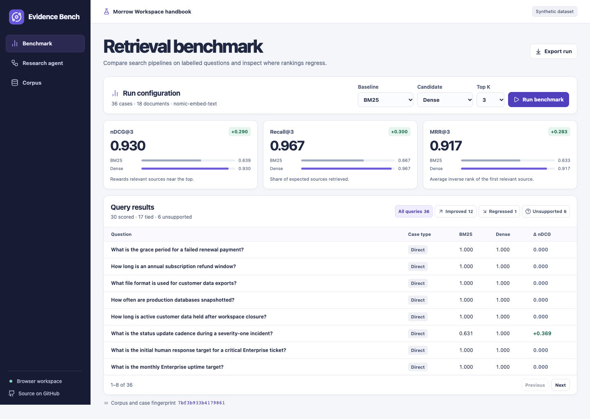

# Evidence Bench

Evaluate the retrieval behind a document assistant and trace how a local research agent finds its evidence. Evidence Bench compares keyword, dense, and hybrid search on labelled questions, highlights query-level regressions, and exports rankings and traces for review.

[Live workspace](https://faaz-rz.github.io/evidence-bench/) · [Design and evaluation notes](docs/design.md)



[See the agent trace](docs/research.png)

## Try it

1. Open **Benchmark**. Compare Dense with BM25 at Top K = 3. The dense ranker makes 12 cases better and one worse on the bundled dataset.
2. Open **Regressed** and inspect the declined-card question. Compare the source rankings and see why a policy document can rank poorly even when the aggregate score rises.
3. Open **Research agent**. Replay a real Ollama run to inspect its evidence or abstention. Switch to **Browser evidence preview** to run interactive searches using the sample vectors or keyword search.
4. In **Corpus**, export the sample workspace JSON, modify the documents and relevance labels, and import it to run your own benchmark.

## Run the local agent

Requires Node.js 24+ and a local Ollama service. The provided embedding and chat models are configurable.

```sh
ollama pull nomic-embed-text
ollama pull qwen3.5:4b
npm ci
npm run build
npm start
```

Open http://127.0.0.1:4328 and choose **Local Ollama agent** on the Research page. Run an outage question to see the planner split it into queries, the retriever rank the source passages, and the verifier select exact excerpts. When support is missing, the agent can try one fallback search and abstain.

The service binds to loopback. Workspace content is sent only to the local service during indexing and model-assisted research. The hosted workspace runs without a server, and imported workspaces live in browser memory for the session.

## Benchmark and regression gate

The bundled fictional handbook has 18 documents and 36 questions. Thirty questions have relevance labels. Six unsupported probes are listed separately and excluded from retrieval averages. All scores below are measured on this fixture and can be reproduced with the CLI.

| Pipeline | nDCG@3 | Recall@3 | MRR@3 |
| --- | ---: | ---: | ---: |
| BM25 | 0.639 | 0.667 | 0.633 |
| Dense | 0.930 | 0.967 | 0.917 |
| Hybrid RRF | 0.843 | 0.933 | 0.811 |

```sh
npm run benchmark -- --gate fixtures/gate.json --out run.json
npm run benchmark -- --baseline bm25 --candidate hybrid --top-k 3
npm run vectors
npm run test:agent
```

The JSON contains the corpus and case fingerprint, model digest, cutoffs, ranked matches, aggregate metrics, and per-question results. The gate exits with status 2 when a candidate misses its configured thresholds. `npm run vectors` rebuilds the sample index with your local embedding model. `npm run test:agent` exercises the planner and verifier with real Ollama inference. Add `-- --record` to regenerate the replay fixture after the checks pass.

For a custom lexical benchmark, pass `--workspace workspace.json --baseline term --candidate bm25`. Use exported JSON from the sample to see the accepted document and case schema.

## Verify

```sh
npm test
npx playwright install chromium
npm run test:browser
```

This is an AI-assisted portfolio project. The walkthrough describes what is measured and where the agent can fail.
